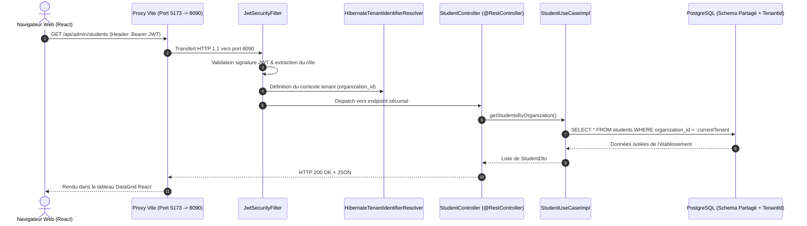

# 🏗️ Spécifications d'Architecture Technique — École 221

> **Système** : ERP Multi-Tenant SaaS Éducatif  
> **Auteur (Agent)** : Software Architect  
> **Validé par (Tech Lead)** : ✅ Validé  
> **Basé sur** : `docs/requirements.md`  
> **Statut** : APPROVED  

---

## 1. Choix Technologiques & Principes Directeurs (ADR)

### ADR-01 : Architecture Hexagonale & DDD Côté Backend (Spring Boot 3)
- **Couche Domaine** : Modèles d'agrégats purs (`Student`, `Course`, `Grade`, `AuditLog`), Factories et Value Objects indépendants de tout framework.
- **Couche Application** : Ports entrants (Use Cases) et DTOs de contrat.
- **Couche Infrastructure** : 
  - Contrôleurs REST Spring MVC (`@RestController`) validant les requêtes DTO.
  - Adaptateurs de persistance JPA / Hibernate 6 avec partitionnement `@TenantId`.

### ADR-02 : Frontend Modulaire Feature-Based (React 18 + Vite 7 + Tailwind)
- Organisation par domaine métier sous `src/features/` (`admin`, `professor`, `student`, `parent`, `vigil`, `super-admin`).
- Découplage strict entre l'UI et les sources de données via des Repositories TypeScript (`ApiStudentRepository`, `ApiProfessorRepository`, etc.).
- Client HTTP centralisé avec intercepteurs pour l'injection du header `Authorization: Bearer <token>` et la gestion de la session.

---

## 2. Diagramme de Séquence : Flux Complet d'une Requête Sécurisée

---

## 3. Matrice de Sécurité & Multi-Tenancy

| Couche | Mécanisme de Protection | Implémentation dans École 221 |
|:---|:---|:---|
| **Contrôle d'Accès** | RBAC (Role-Based Access Control) | Annotations `@PreAuthorize` et matcher Spring Security (`/super-admin/**`, `/admin/**`, etc.) |
| **Isolation Données** | Row-Level Partitioning | Annotation `@TenantId` sur toutes les entités de l'établissement + `CurrentTenantContext` |
| **Protection Réseau** | CORS & Proxy Inversé | Vite Proxy en développement (`target: 127.0.0.1:8090`), configuration CORS Spring stricte |
| **Audit & Traçabilité** | Immutabilité des Journaux | Module `AuditUseCase` journalisant horodatage, auteur, adresse IP et sévérité |
| **Temps Réel Sécurisé** | Authentification STOMP | Connexion WebSocket sur `http://localhost:8090/api/ws` avec validation du token |
